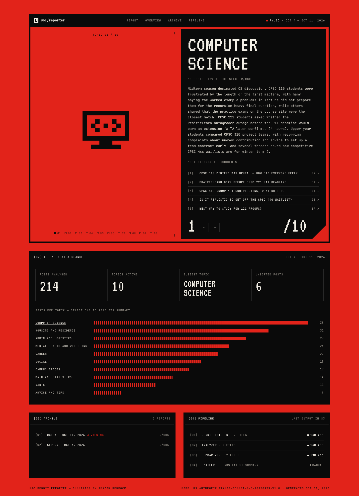

# UBC Reddit Reporter

[](https://github.com/ojasvissar/ubc-reddit-reporter/actions/workflows/ci.yml)

**A weekly briefing on what UBC students are actually talking about.** UBC Reddit Reporter surfaces the concerns and experiences students share on r/UBC. Every week it collects the posts, sorts each one into a topic with Amazon Bedrock, writes a summary of every topic, then emails the report as a newsletter and publishes it to a dashboard. It runs serverless on AWS (SAM, Lambda, S3, EventBridge, API Gateway).

Built at the [UBC Cloud Innovation Centre's Fall 2025 Generative AI Hackathon](https://cic.ubc.ca/2025/12/04/innovation-in-action-a-look-at-student-projects-from-the-fall-2025-hackathon/); see [Team](#team).


<sub>Dashboard running locally with sample data (`make dashboard`).</sub>

## How it works

```
 Reddit ─▶ [1] Fetch ─▶ [2] Classify ─▶ [3] Summarize ─▶ [4] Email
             PRAW        Bedrock          Bedrock         Postmark
              │             │                 │
              └──────── S3 data bucket ───────┴──▶ [5] Dashboard (HTTP API)
```

| Step | Lambda | Output |
|---|---|---|
| Fetch | `reddit_fetcher.py` | The last 7 days of posts and comments, saved to `reddit_parquet/` |
| Classify | `analyzer.py` | Each post tagged with one of 14 topics (parallel Bedrock calls), saved to `classifications/` |
| Summarize | `summarizer.py` | One summary per topic plus the most-discussed posts, saved to `summaries/*.json` and `summaries/*.txt` |
| Email | `emailer.py` | The latest report sent through a Postmark template |
| Dashboard | `api.py` + `web/index.html` | Read-only web UI and JSON API for every report |

Bedrock is called through the Converse API, so any Bedrock text model works for either step: Claude, Llama, Nova, or a cross-region inference profile.

## Quick start

```bash
make install     # Python 3.13 dev dependencies
make test        # 44 tests, including an end-to-end pipeline run with faked AWS calls
make dashboard   # http://127.0.0.1:8000 with sample data, no AWS needed
```

## Deploy

```bash
sam build
sam deploy --guided \
  --parameter-overrides RedditClientId=... RedditClientSecret=... PostmarkServerToken=... \
                        FromEmail=you@ubc.ca ToEmail=team@ubc.ca
```

After deploying, the `DashboardUrl` stack output is the dashboard's address. To run the whole pipeline once by hand:

```bash
make invoke-reddit-fetcher-remote invoke-analyzer-remote invoke-summarizer-remote invoke-emailer-remote
```

The fetcher and analyzer also run weekly on EventBridge schedules. Run the summarizer and emailer by hand, or add schedules for them.

<details>
<summary>Parameters</summary>

| Parameter | Default | Notes |
|---|---|---|
| `CategorizationModelId` / `SummarizationModelId` | `us.anthropic.claude-sonnet-4-5-20250929-v1:0` | Any Bedrock model or inference profile ID |
| `RedditClientId` / `RedditClientSecret` | — | Credentials from a "script" app at reddit.com/prefs/apps |
| `RedditSubreddit` | `UBC` | Comma-separate several, e.g. `UBC,UBCO` |
| `PostmarkServerToken`, `FromEmail`, `ToEmail`, `TemplateAlias` | — | The sender address must be verified in Postmark |
| `RedditFetchSchedule` / `AnalysisSchedule` | `rate(7 days)` | Turn either off with `Enable…Schedule=false` |
| `PandasLayerArn` | Python 3.13 layer, `us-west-2` | In other regions, use the matching [AWS SDK for pandas layer](https://aws-sdk-pandas.readthedocs.io/en/stable/layers.html) |

</details>

<details>
<summary>API and event options</summary>

| Endpoint | Returns |
|---|---|
| `GET /api/reports` | Report IDs, newest first |
| `GET /api/reports/latest` · `/api/reports/{id}` | One report: topics, summaries, top posts |
| `GET /api/status` | Time of the last output from each pipeline step |

Optional fields in the event payload when invoking a function:

| Function | Field | Effect |
|---|---|---|
| Fetcher | `days_back` | Number of days of posts to fetch (default 7) |
| Analyzer | `key`, `force` | Classify one file; re-classify a file that already has results |
| Summarizer | `key` | Summarize a specific `classifications/…` file |
| Emailer | `key` | Send a specific summary text file |

</details>

## Project layout

```
src/            Lambda handlers, common.py (S3 + Bedrock helpers), prompts/, web/
tests/          pytest suite with in-memory S3 and Bedrock fakes
scripts/        dev_server.py (local dashboard), invoke-lambda.sh, sample_data/
template.yaml   SAM stack: 5 functions, S3 bucket, HTTP API, schedules, IAM
```

To change the topic list, edit `prompts/classify_post.jinja`, `CATEGORIES` in `analyzer.py`, and `CATEGORY_PROMPTS` in `summarizer.py`, and add a summary prompt ending in `{{ posts }}`. The tests fail if these drift apart.

## Team

Built by **Tanav Bajaj, Ojasv Issar, Shreya Kakachery, Vinay Valson and Prabuddha Tamhane** at the UBC Cloud Innovation Centre's Fall 2025 Generative AI Hackathon. Read about it in [Innovation in Action: A Look at Student Projects from the Fall 2025 Hackathon](https://cic.ubc.ca/2025/12/04/innovation-in-action-a-look-at-student-projects-from-the-fall-2025-hackathon/).

This repository is a fork of the original hackathon repo, [Vin-dictive/ubc-reddit-reporter](https://github.com/Vin-dictive/ubc-reddit-reporter), and continues its development.
